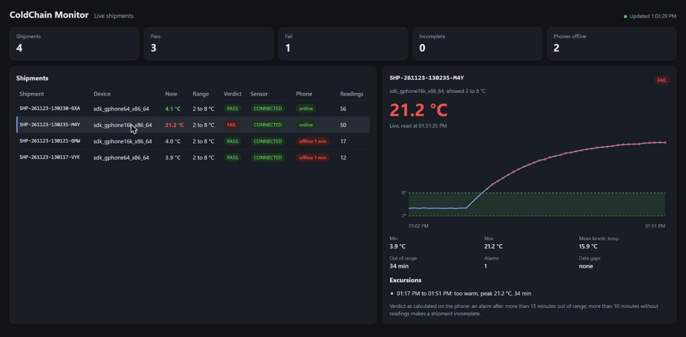
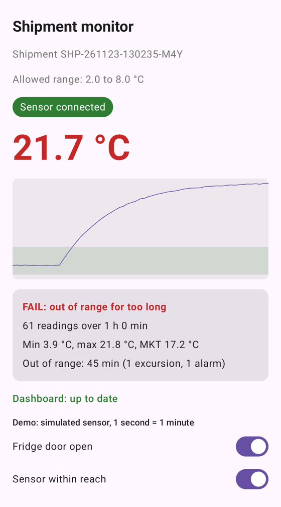
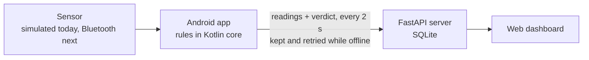

# ColdChain Monitor

An Android app that watches the temperature of goods that must stay cold and says clearly whether a shipment
stayed within its range: **pass**, **fail**, or **incomplete** when the data has gaps. In the warehouse it
checks the goods automatically at **goods receipt** and keeps them cold during **picking**. A web dashboard
shows every shipment live, like a small control room.

Built in Kotlin with Jetpack Compose, with a FastAPI server for the dashboard. Today the app runs on a
simulated fridge sensor; a Bluetooth sensor plugs in behind the same interface (see [TASKS.md](TASKS.md)).



## Why

I work in grocery delivery operations in Berlin, where freshness checks under HACCP rules are part of every
shift. Temperature is the part you cannot check by looking at the shelf. This app logs it continuously and flags
problems instead of relying on spot checks.

## What it does

**On the phone**

- Live temperature with the sensor's connection state (looking, connected, lost, reconnecting).
- A chart of the last two hours against the allowed band. A stale reading is greyed out, never shown as live.
- A shipment report: excursions, time out of range, min and max, mean kinetic temperature, data gaps, verdict.
- Demo switches: leave the fridge door open to cause an excursion, or move the sensor out of reach to cause a
  data gap. The simulator runs one simulated minute per second, so its timestamps run ahead of the clock.

**In the warehouse**

- **Goods receipt:** when the shipment is scanned in at the dock, the app checks it on its own: the temperature
  on arrival and the whole trip's history. No one has to probe the goods, and a load that warmed up on the road
  and cooled down again before arrival is still caught.
- **Picking:** a timer starts when the goods leave the cold room and stops when they are packed into a cool box.
  The picker sees the time left and the temperature, and a red warning the moment a limit breaks.
- Only accepted goods can be picked. A demo button stands in for the dock scan, and the simulator warms picked
  goods slowly, the way products in a tote do.

**On the dashboard**

- Every shipment with its live temperature, verdict, warehouse stage, sensor state and whether the phone is
  still reporting.
- Totals for pass, fail, incomplete, goods held at the dock and phones offline.
- A chart, the excursion list, and the receipt and picking checks for the selected shipment.



## How it decides

| Rule | Default |
|---|---|
| Allowed range | 2 to 8 °C (chilled). Frozen (-18 °C or colder) and 15 to 25 °C are built in too. |
| Alarm | Out of range for **longer than 15 minutes** in one stretch. Shorter excursions are logged, not failed. |
| Data gap | No reading for **more than 10 minutes**. That time is unknown, so it never counts as in range. |
| Verdict | FAIL if there is any alarm; otherwise INCOMPLETE if there is any gap; otherwise PASS. |
| Mean kinetic temperature | One number that weighs warm periods more, as used in pharma storage (ΔH/R = 10,000 K). |
| Goods receipt | **Reject** if the goods arrive out of range or had an alarm in transit. **Quarantine** if the trip has gaps or there is no reading from the last 10 minutes: quality decides. Otherwise **accept**. |
| Picking | At most **20 minutes** out of the cold room, never out of range, and never more than 10 minutes without readings. Otherwise the picking fails. |

## How it fits together



- The rules live only in the Kotlin `core`. The phone sends its verdict and warehouse checks along with the
  readings, so the server never recalculates or second-guesses them.
- If the server cannot be reached, readings wait on the phone and go out with the next successful upload.
  The server stores each reading once, so retries never create duplicates.
- The dashboard marks a phone offline after 15 seconds without an upload, separately from the sensor's own
  connection state.

```
core/     plain Kotlin, no Android: shipment and warehouse rules, Bluetooth decoder, simulator, upload queue, tests
app/      the Android app (Jetpack Compose)
server/   FastAPI + SQLAlchemy server and the dashboard page, with tests
```

## Run it

**Dashboard server** (Python 3.11+):

```
cd server
python -m venv .venv
.venv\Scripts\activate            (macOS/Linux: source .venv/bin/activate)
pip install -r requirements.txt
uvicorn app.main:create_app --factory --port 8000
```

Open http://localhost:8000. Delete `server/coldchain.db` to start with an empty dashboard.

**App:** open this folder in Android Studio and run `app` on an emulator: it reaches the server at
`10.0.2.2:8000`. For a real phone on the same Wi-Fi, start the server with `--host 0.0.0.0` and install with
`./gradlew installDebug -PdashboardUrl=http://<your PC's IP>:8000`.

**Tests:** `./gradlew :core:test` for the Kotlin rules, `pytest` in `server/` for the API.
GitHub Actions runs both and builds the app on every push.

## How I used AI

_To write in my own words: which parts the AI drafted, what I changed, and what the tests caught._
